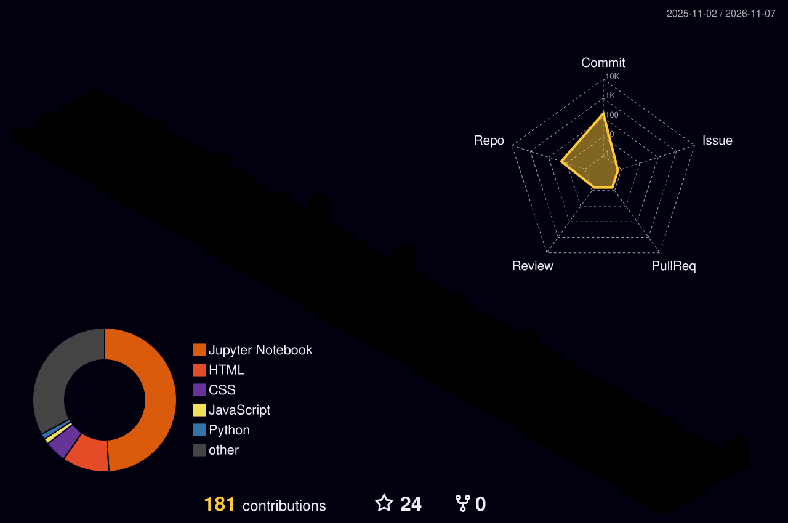

  

<h1 align="center">
  
</h1>

  
  
  

---

## 👨‍💻 About Me

- 🎓 BS Artificial Intelligence student at Superior University Lahore (5th semester)
- 🤖 I build and ship working AI systems: ML models, computer vision pipelines and AI agents
- 🧠 Python, TensorFlow, PyTorch, Scikit-learn, OpenCV, YOLOv8
- 🔗 RAG chatbots and multi-agent automation with n8n, Make.com and the Gemini / OpenAI APIs
- 🌐 Web apps with Flask and React, deployed on Vercel
- 💼 **Open for freelance work** (see services below)

---

## 🛠 Services

| Service | What you get |
|---|---|
| 🤖 AI Chatbot / RAG Assistant | A bot that answers only from your documents |
| ⚙️ Automation & AI Agents | Forms, Sheets, Gmail and Calendar workflows that run by themselves |
| 🌐 AI-powered Website | Responsive site with an AI feature |
| 👁️ Computer Vision Demo | Real-time object detection on video |

📩 **To order:** email me or message me on LinkedIn.

---

## 🚀 Featured Projects

| Project | What it does | Stack |
|---|---|---|
| 🧠 **RAG Knowledge Assistant** | Answers strictly from company documents and says "not found" instead of making things up | Python, n8n, Supabase, Gemini |
| 🤖 **Multi-Agent Automation** | AI executive assistant (meetings, email, CRM) and a PR campaign agent system | n8n, Google Sheets, Gmail, Calendar |
| 🩺 **[MediBot](https://dr-med-ten.vercel.app)** | Live AI health assistant with safety disclaimers | Flask, Llama 3.1 (Groq), JavaScript |
| 👁️ **Real-Time Object Detection** | Low-latency detection on live video | Python, OpenCV, YOLOv8 |

<b>More ML projects</b>

- 🎬 [Movie Recommendation System](https://github.com/Nauman804/REPLACE-WITH-REPO-NAME): content-based filtering
- 🏠 [House Price Prediction](https://github.com/Nauman804/REPLACE-WITH-REPO-NAME): regression
- 📊 [Customer Segmentation](https://github.com/Nauman804/REPLACE-WITH-REPO-NAME): K-Means clustering
- 📧 [Spam Detection](https://github.com/Nauman804/REPLACE-WITH-REPO-NAME): NLP classifier
- 💬 [Flask Chatbot](https://github.com/Nauman804/REPLACE-WITH-REPO-NAME): NLP chatbot
- 🌦 [Weather App](https://github.com/Nauman804/REPLACE-WITH-REPO-NAME): live weather API

👉 Full list and live demos: **[nauman804.github.io/Portofolio](https://nauman804.github.io/Portofolio/)**

---

## 🧠 Tech Stack

  

  
  
  
  
  
  

---

## 🧊 My Contributions in 3D

  

## 📊 GitHub Stats

  
  

  

## 🐍 Contribution Snake

  <picture>
    <source media="(prefers-color-scheme: dark)" srcset="https://raw.githubusercontent.com/Nauman804/Nauman804/output/github-snake-dark.svg"/>
    
  </picture>

---

  <i>♛ GÖKBÖRÜ AI: building practical AI systems for real businesses.</i>

  

